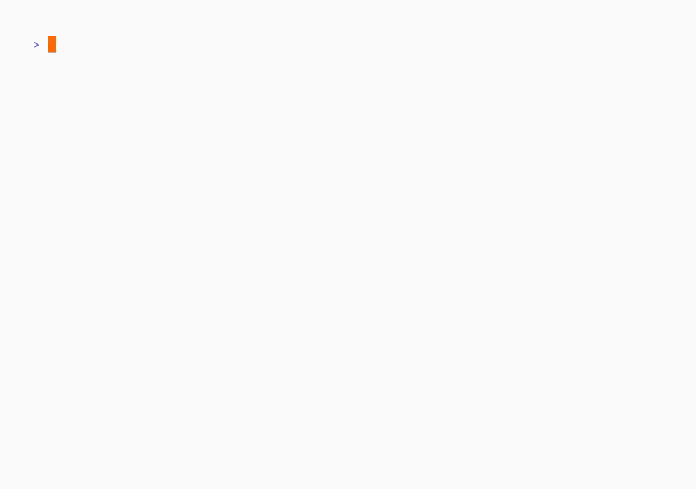
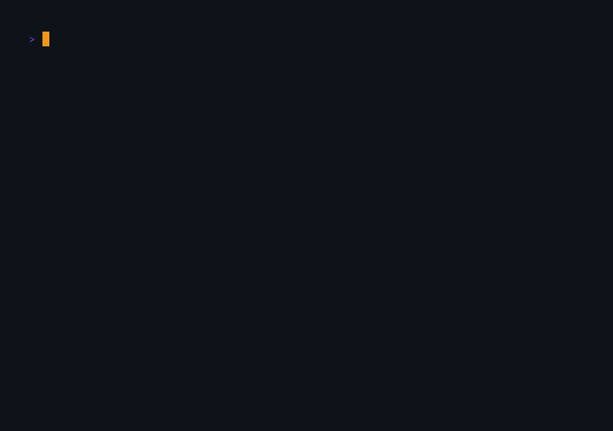

.. toctree::
   :hidden:
   :maxdepth: 2
   :caption: Users

   Overview <self>
   usage/tutorials/index
   usage/how-to/index
   usage/reference/index
   usage/explanation/index

.. toctree::
   :hidden:
   :maxdepth: 2
   :caption: Developers

   developers/build
   developers/contributing
   developers/style
   developers/memory
   developers/modules/index
   developers/packets_processing
   developers/generation
   developers/tests

.. toctree::
   :hidden:
   :caption: External

   GitHub repository <https://github.com/facebook/bpfilter>
   Slack community <https://join.slack.com/t/bpfilter/shared_invite/zt-4d89whuae-JnJJ~h0zpdHwzP7wyYQpwA>
   external/benchmarks/index
   external/coverage/index

|
|

.. raw:: html

   <h5 align="center">An <a href="https://ebpf.io/">eBPF</a>-based packet filtering framework.</h5>

|

**bpfilter** transforms how you control network traffic by leveraging the power of eBPF technology. This framework elegantly translates filtering rules into optimized BPF programs, bringing unparalleled performance and flexibility to your packet filtering needs.

|

|

.. raw:: html

   <h5>Key features</h5>

- **High performance**: utilizes eBPF's near-native performance capabilities
- **Low overhead**: minimal resource consumption with maximized efficiency
- **Developer-friendly**: clean architecture with clear separation of components

**bpfilter** combines two components: ``bfcli``, a CLI that allows users to define filtering rules in human-readable text, and ``libbpfilter``, a library that converts these rules into efficient BPF programs and manages their lifecycle.

Want to know more about **bpfilter**?

- **New to bpfilter?** :doc:`Install it <usage/how-to/install>`, then follow :doc:`usage/tutorials/first-chain`.
- **Complete a task**: :doc:`usage/how-to/index` cover installing **bpfilter** and applying, updating, inspecting, and removing filters.
- **Look up syntax or behavior**: :doc:`usage/reference/index` describes the ``bfcli`` commands and the ruleset syntax.
- **Understand how filtering works**: :doc:`usage/explanation/index` explains rule evaluation, hook placement, and the chain lifecycle.
- **Work on bpfilter**: the :doc:`developer documentation <developers/build>` covers building, contributing, and the code base.

You can also watch our talk at `Scale <https://www.youtube.com/watch?v=fzaPEm4PXn0>`_!

.. raw:: html

   <h5>Community</h5>

Join the `bpfilter Slack workspace <https://join.slack.com/t/bpfilter/shared_invite/zt-4d89whuae-JnJJ~h0zpdHwzP7wyYQpwA>`_ to ask questions, discuss development, and share feedback.
